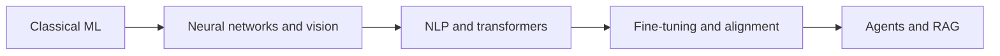

# AI Engineering Study Portfolio

**From classical machine learning to deep learning, transformers, fine-tuning and retrieval.**

A personal study repository following the [IBM AI Engineering Professional Certificate](https://www.coursera.org/professional-certificates/ai-engineer). It turns collected course material into a navigable reference for revision, experimentation and technical interviews.

**13 course study guides · 138 distinct course notebooks · 2 integration guides · 3 executed companion examples**

> Course notebooks retain IBM / Skills Network authorship and exercise blanks. The companion examples were created with AI assistance during curation and are separately identified. Execution evidence covers the three companions, not the full course collection. This repository is currently a private study archive.

## Start here

| Your goal | Open |
|---|---|
| Review a concept and find its lab | [Course catalog](docs/LAB_CATALOG.md) |
| Work through a structured revision plan | [Study roadmap](docs/STUDY_ROADMAP.md) |
| Run a small, verified example | [Companion notebooks](companions/README.md) |
| Recreate the local environment | [Setup and compatibility notes](docs/SETUP.md) |
| Inspect what was actually verified | [Validation evidence](docs/VALIDATION.md) |
| Understand source ownership and curation | [Attribution and provenance](docs/ATTRIBUTION.md) |

## Runnable examples

The companions use local or bundled data and CPU execution. They need no API key, hosted model, dataset download or cloud account after installing dependencies.

| Example | Engineering practice | Evidence |
|---|---|---|
| [ML pipeline and evaluation](companions/01-ml-pipeline-and-evaluation.ipynb) | Training-only preprocessing, cross-validation, dummy baseline, held-out test | Saved metrics and confusion matrix |
| [PyTorch training and checkpoint](companions/02-pytorch-training-and-checkpoint.ipynb) | Train/validation/test split, best-epoch selection, exact checkpoint reload | Saved metrics and learning curves |
| [Local retrieval and source tracing](companions/03-local-retrieval-and-source-tracing.ipynb) | Chunking, lexical ranking, stable source IDs, unsupported-query checks | Source packets and Hit@k sanity checks |

The retrieval companion has no generative model. Small teaching datasets and handcrafted queries illustrate workflows; their scores are not production benchmarks.

## Curriculum



Each course page contains core concepts, a working formula or model, suggested starting labs, common mistakes and questions for active recall.

| Course | Focus | Notebooks |
|---|---|---:|
| [01 · Machine Learning with Python](courses/01-machine-learning-with-python/README.md) | Regression, classification, clustering, evaluation | 20 |
| [02 · Keras foundations](courses/02-deep-learning-with-keras/README.md) | Forward/backpropagation, activations, first neural models | 8 |
| [03 · Keras and TensorFlow](courses/03-keras-and-tensorflow/README.md) | Custom models, transfer learning, generative models, RL | 16 |
| [04 · PyTorch foundations](courses/04-pytorch-foundations/README.md) | Tensors, autograd, datasets, training loops | 20 |
| [05 · Deep Learning with PyTorch](courses/05-deep-learning-with-pytorch/README.md) | Initialization, regularization, CNNs | 28 |
| [06 · Computer vision capstone](courses/06-computer-vision-capstone/README.md) | Satellite classification, Keras/PyTorch comparison, CNN–ViT | 9 |
| [07 · LLM data preparation](courses/07-llm-data-preparation/README.md) | Tokenization and data loaders | 3 |
| [08 · Foundational NLP models](courses/08-foundational-nlp-models/README.md) | N-grams, embeddings, sequence models | 6 |
| [09 · Transformer language models](courses/09-transformer-language-models/README.md) | Attention, BERT-style encoders, causal decoders | 6 |
| [10 · Fine-tuning transformers](courses/10-fine-tuning-transformers/README.md) | Pretraining, adapters, LoRA, inference | 6 |
| [11 · Advanced fine-tuning](courses/11-advanced-fine-tuning/README.md) | Instruction tuning, reward modeling, PPO, DPO | 4 |
| [12 · AI agents and RAG](courses/12-ai-agents-and-rag/README.md) | Prompting, retrieval, LangChain, tools | 6 |
| [13 · RAG application project](courses/13-rag-application-project/README.md) | Document ingestion, vector stores, retrieval, Gradio guides | 6 + 2 guides |

## Quick start

Use Python 3.11 in an isolated virtual environment. Install the CPU build of PyTorch appropriate for your platform; [setup](docs/SETUP.md) gives the full commands, including Linux CPU installation.

```bash
python3.11 -m venv .venv
source .venv/bin/activate
python -m pip install -r requirements/companions.txt -r requirements/quality.txt
python scripts/check_repository.py
python scripts/run_companions.py
```

On Windows, activate with `.venv\Scripts\Activate.ps1`. The course reference notebooks have independent dependency requirements; this environment is verified for the companions and repository tooling.

## Repository structure

```text
courses/       13 course folders, study notes, reference notebooks and guides
companions/    Three locally executed examples with saved outputs
docs/          Catalog, revision plan, setup, attribution and validation
provenance/    Source hashes, original-to-curated paths and course definitions
reports/       Deterministic lab audit and measured companion execution results
requirements/  Pinned direct dependencies for examples and quality checks
scripts/       Import, catalog generation, integrity checks and example runner
```

149 source assets are traceable to 140 curated files. Nine copies with identical cell types and source text within the same course were consolidated. Cross-course shared labs remain available in their respective courses. The original download archive is outside this Git repository and unchanged.

## Separate capstone: Mevzuat RAG

Mevzuat RAG will be linked later as a separate capstone project and case study. Its source, experiments and results are not bundled here. Course 06 contains the certificate's collected computer vision capstone material; course 13 contains the collected RAG application references.

For a future CV or LinkedIn presentation, use the [portfolio evidence brief](docs/PORTFOLIO.md) to distinguish course coverage, repository work and independently measured results.
